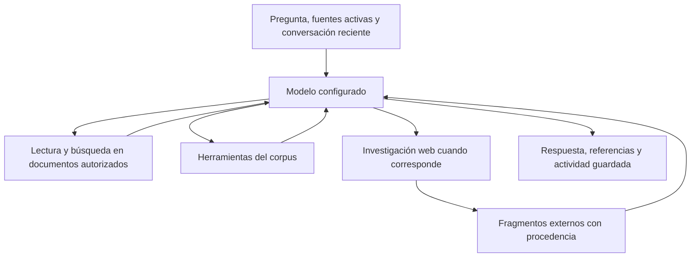

# Conversar sobre documentos con DiscourseLens

DiscourseLens combina un modelo elegido por el investigador con herramientas
del motor documental y métodos descritos mediante instrucciones versionadas.
El motor recupera texto, localiza pasajes y realiza operaciones del corpus; el
modelo propone interpretaciones y decide qué herramientas necesita. La calidad
de esa interpretación depende del modelo, del material disponible y de la
pregunta. Las referencias permiten revisarla; no la convierten automáticamente
en una conclusión válida.

## Empezar y cambiar de profundidad

Abre un proyecto, incorpora o selecciona sus fuentes y configura un modelo de
chat con una credencial propia. En una conversación nueva puedes escribir
libremente o usar «Guíame en la lectura», «Discutamos una interpretación» y
«Exploremos un patrón». Esos botones preparan una pregunta editable.

Puedes pedir, por ejemplo:

- Una lectura guiada: «No sé lingüística; explícame una elección de lenguaje
  con un ejemplo y un paso para continuar».
- Una interpretación: «¿Qué ideologías organiza este programa y mediante qué
  propuestas y formulaciones?».
- Una discusión: «Esa conclusión confunde evaluación y presuposición; contrástala
  con el pasaje y una explicación alternativa».
- Una investigación del corpus: «Cuenta este token, precisa el alcance y explica
  qué permite concluir el recuento».
- Ayuda de escritura: «Redacta un comentario que distinga observación textual,
  interpretación y alternativa; identifica tu redacción y las citas originales».

No hace falta elegir de antemano un nivel o un marco. Las instrucciones del chat
piden adaptar la explicación, responder a las objeciones y revisar lecturas
anteriores cuando la evidencia lo justifica. Puedes pedir un método concreto e
inspeccionar sus instrucciones. Eso es distinto de disponer de una implementación
formal completa de cada teoría: la interpretación la sigue realizando el modelo.

## Cómo se construye una respuesta

Es un recorrido con decisiones del modelo y varias llamadas posibles, no una
secuencia fija de todos los métodos para cada pregunta.

Para preguntas globales, `read_document` permite leer un intervalo continuo de
hasta 100.000 caracteres y 128 unidades de origen. Devuelve páginas o párrafos,
coordenadas canónicas, cobertura y continuación. El chat recibe instrucciones
de leer completo lo que cabe y continuar o justificar una selección cuando sea
mayor. El transporte conserva la lectura primaria con prioridad dentro de un
presupuesto acotado. Una lectura completa tampoco equivale a una anotación
exhaustiva de cada fenómeno del documento.

Para un primer análisis sustantivo de un documento público con autor
identificable, la política pide establecer autoría y voz institucional,
trayectoria pública relevante, fecha, género, destinatarios, propósito, actores
y situación sociopolítica. Una comprobación puede pedir que complete la
investigación contextual antes de publicar la primera interpretación. Se
respetan las peticiones de analizar solo el texto, las fuentes privadas o no
identificables y los bloqueos de acceso.

`research_web_context` usa la búsqueda web nativa del preset OpenAI seleccionado.
Solicita antecedentes del autor o institución antes de los datos del acto de
publicación y descarga hasta dos fuentes devueltas. `fetch_web_source` permite
leer fuentes adicionales por URL. El resumen de búsqueda se trata como pista;
el modelo debe apoyar los datos contextuales en fragmentos realmente leídos.
Hay que distinguir la fecha del escrito, su circulación, la fecha de una noticia
y los acontecimientos posteriores.

La interpretación distingue tres planos: lo que el documento construye o
propone, lo que aportan fuentes externas fechadas y la inferencia teórica del
analista. En los métodos sociocognitivos también se diferencian ideologías,
actitudes sobre asuntos concretos, modelos de situación y modelos de contexto.
El texto puede apoyar una lectura ideológica sin revelar directamente la mente
de una persona ni demostrar la respuesta de su público.

## Qué queda guardado y cómo revisarlo

Los mensajes conservan la respuesta y los resultados de las herramientas. «Ver
pasajes y fuentes» muestra extractos y referencias; «Actividad del análisis»
permite revisar las operaciones, argumentos y resultados consultados. Las
fuentes externas incluyen enlaces HTTP(S) que se pueden abrir. Las referencias
del documento utilizan sus localizaciones; un nombre de archivo no se convierte
en una supuesta URL de descarga.

Los fragmentos descargados se guardan como contexto externo, separado del
documento principal, con URL, título, fecha de consulta, huella del contenido y
procedencia de adquisición. Se conserva el extracto, no una copia íntegra
garantizada de toda la web. La fecha de publicación extraída de una página se
identifica como declarada por esa fuente. Un registro de descarga prueba qué se
consultó; no verifica por sí solo la verdad de todas sus afirmaciones. El
contexto aportado por una persona tampoco se relabela como descargado.

El historial se almacena en el proyecto. La entrada reciente del modelo usa
hasta doce mensajes y un presupuesto de 32.000 caracteres, dando prioridad a la
discusión y a datos acotados de procedencia. No es una memoria semántica
permanente: puede necesitar recuperar otra vez un pasaje o una fuente anterior.
Además, un registro acotado recupera identificadores y procedencia de fuentes
anteriores aunque hayan salido de esos doce mensajes. Los metadatos se resuelven
contra los artefactos del motor: las interpretaciones antiguas no se convierten
por ello en hechos. Esto permite volver a consultar un fragmento guardado sin
repetir una búsqueda web solo porque envejeció la conversación.

## Proveedores, conexión y límites

La búsqueda automática de contexto requiere actualmente un preset OpenAI con
soporte de búsqueda web nativa. La descarga directa por URL puede utilizarse con
otros proveedores. El modo sin conexión bloquea búsqueda y descarga; los errores
de acceso o de compatibilidad deben quedar como lagunas concretas del análisis.

La descarga admite HTML, texto y PDF con texto extraíble: tiene un límite de
2 MiB por respuesta y de 20.000 caracteres por fragmento. No ejecuta JavaScript
ni hace OCR de PDFs web escaneados. Rechaza direcciones privadas, URLs con
credenciales y redirecciones a destinos privados.

El texto documental consultado, las preguntas y los fragmentos externos pueden
entrar en el contexto del modelo remoto. Las instrucciones de búsqueda piden
usar metadatos públicos, como nombres, títulos y fechas; no constituyen un
mecanismo automático de anonimización. Las llamadas de modelo y búsqueda pueden
generar costes del proveedor. Revisa la [configuración web](WEB_DEPLOYMENT.md)
y [modelos y privacidad](../README.md#models-and-privacy).

El indicador junto a los ajustes del chat permite establecer un saldo manual
y ver cómo disminuye con el consumo registrado. Requiere tarifas guardadas y
uso confirmado; muestra una estimación del presupuesto, no el crédito real del
proveedor. Véase [saldo y consumo](SPENDING.es.md), incluidos los cargos que
cuenta, los que excluye y cómo trata los costes desconocidos.

En la validación con el modelo configurado se observaron consultas de análisis
de varios minutos. También se detectó y corrigió una paráfrasis imprecisa tras
volver al PDF. Conviene contrastar las citas académicas con el original: la
extracción puede contener cortes de línea y OCR, y una respuesta puede
normalizarlos o equivocarse al interpretar una relación gramatical.

La prueba documentada acredita comportamientos concretos de conversación,
contextualización y trazabilidad. Queda pendiente una evaluación experta de la
calidad disciplinar; no certifica equivalencia con un lingüista humano. Véase el
[informe de validación](architecture/CONTEXTUAL_ANALYSIS_VALIDATION.md) y los
métodos de [ideología](methodology/van-dijk-ideology-review-v2.md) y
[análisis sociocognitivo](methodology/sociocognitive-review-v2.md).
